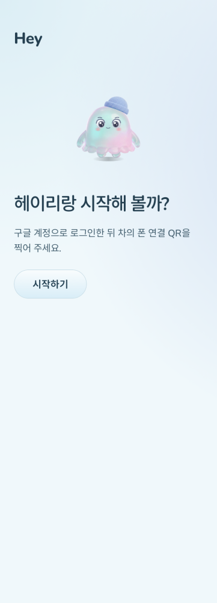
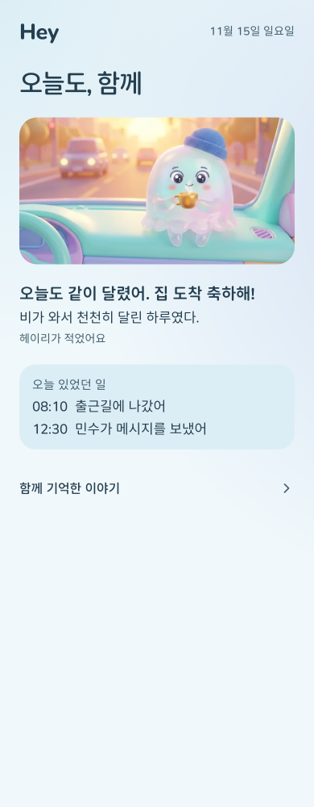
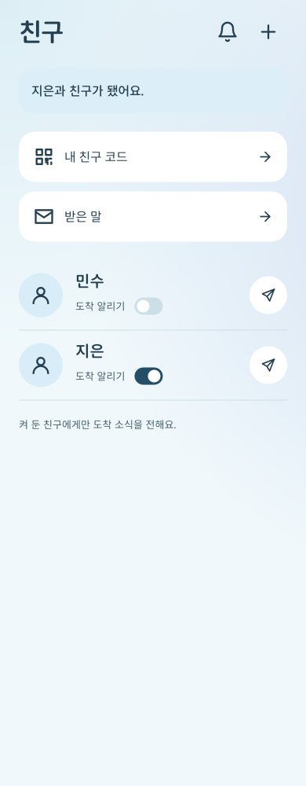

<div align="center">
  

  # Hey 폰 앱

  차 안의 캐릭터 AI 친구 **헤이리**를 폰에서 만나는 Android 앱.<br />
  차와 연결하고, 같이 다닌 하루를 읽고, 친구와 소식을 주고받아요.
</div>

<p align="center">
  
  
  
</p>

[Team Hey](https://github.com/teamhey-challenge)가 만든 Pleos 차량 앱 [companion-car](https://github.com/teamhey-challenge/companion-car)의 짝꿍 앱입니다. Jetpack Compose, `ai.hey.phone`, minSdk 28 / targetSdk 35.

## 기능

- **Google 로그인**: 시작 화면에서 Google 계정으로 로그인하고 동의 항목을 고릅니다.
- **차 연결**: 차 화면의 QR을 찍거나 8자리 연결 코드를 직접 넣어 차와 연결합니다. 연결 링크(`https://hey.lastmile.ltd/p/{코드}`)를 열어도 됩니다.
- **오늘과 일기**: 같이 다닌 하루와 헤이리가 적은 한 줄 일기, 오늘 있었던 일을 봅니다.
- **친구**: 친구 코드·링크로 친구를 추가하고, 요청을 받고, 메시지를 주고받고, 도착을 알립니다. 새 소식은 알림으로 옵니다.
- **기억**: 헤이리가 기억하는 이야기를 보고 하나씩 또는 전부 지웁니다.
- **설정**: 이름, 기억 켜기·끄기, 차 연결 해제.
- **로그아웃**: 차 연결을 해제하면 이 폰이 로그아웃되고, 저장된 토큰과 Google 로그인 상태가 정리됩니다.

폰 다크 모드는 시스템 설정을 따르고, 글자 크기 1.3배에서도 레이아웃이 유지됩니다.

## 구조

```text
app/src/main/kotlin/ai/hey/phone/
├── ui/             디자인 시스템 컴포넌트 (화면은 이것만 사용)
├── data/           ApiClient(OkHttp + kotlinx.serialization), 토큰 저장, Google 로그인
├── nav/            화면 경로, 딥링크 해석
├── notify/         알림, 백그라운드 작업
└── feature/        login · pair · home · friends · talk · memory
app/src/test/       단위 시험과 Paparazzi 화면 스냅숏 (snapshots/images)
shared/             companion-shared 서브모듈 (디자인 토큰·글꼴)
scripts/            APK 정리 스크립트
```

## 빌드와 실행

필요한 것: JDK 17, Android SDK(API 35).

```bash
git clone --recurse-submodules https://github.com/teamhey-challenge/companion-phone.git
cd companion-phone
./gradlew :app:assembleDebug      # 디버그 APK
./gradlew :app:assembleRelease    # R8 축소 릴리스 APK
adb install app/build/outputs/apk/debug/app-debug.apk
```

이미 클론했다면 `git submodule update --init`으로 `shared/`를 받습니다.

| 옵션 | 뜻 | 기본값 |
|---|---|---|
| `-PserverUrl=https://…` | 서버 주소(https만) | `https://hey.lastmile.ltd/api` |
| `-PgoogleServerClientId=…` | Google 웹 클라이언트 ID. 빈 값이면 Google 버튼이 꺼지고 QR 경로만 동작 | 팀 클라이언트 ID |

> [!IMPORTANT]
> Google 로그인은 등록된 키로 서명한 APK에서만 됩니다. 다른 컴퓨터에서 만든 디버그 APK는 서명 키가 달라 로그인할 수 없습니다. 직접 빌드해서 로그인까지 써 보려면 본인 서명 키와 Google OAuth 클라이언트를 등록하세요. 릴리스 서명은 `~/.config/hey/signing.properties`가 있으면 그 키를 쓰고, 없으면 디버그 키로 서명합니다.

## 테스트

```bash
./check.sh                              # 디버그 빌드 + 단위 시험 + 검사
./gradlew testDebugUnitTest             # 단위 시험만
./gradlew verifyPaparazziDebug          # 화면 스냅숏 비교
```

스냅숏 기준 이미지는 CI가 기록합니다(`record-snapshots` 워크플로). 위 스크린샷도 이 이미지입니다.

## APK

- 저장소: [`apk/TeamHey_Hey-phone_release.apk`](apk/TeamHey_Hey-phone_release.apk) (릴리스 키 서명본)
- 최신 빌드: https://hey.lastmile.ltd/download/phone/latest.apk

## 개인정보

[개인정보 처리방침](https://hey.lastmile.ltd/privacy)

## 라이선스

[MIT](LICENSE)
